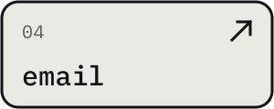

<picture>
  <source media="(prefers-color-scheme: dark)" srcset="assets/header-dark.svg">
  
</picture>

  
  
  
  

### 00 — about

Projects in data engineering, DevOps and MLOps, each written as **Situation · Task · Action · Result · Learning**.
Every project links to its code, every number comes from that repository, and every credential links to where it can be verified.

### 01 — projects

#### [DataOps lakehouse for e-commerce analytics](https://github.com/adriansalvadorekomo/DataOps-Lakehouse-for-E-commerce-Analytics)
personal project · built alone · aug – oct 2026

- **Situation** — E-commerce reports that query the operational database directly come with no guarantee that the numbers are right.
- **Task** — Build a lakehouse where bad data cannot reach the reporting layer, and every change is tested before it ships.
- **Action** — PostgreSQL system of record → Databricks Bronze / Silver / Gold in Spark SQL (Delta Lake, Unity Catalog), run as a Databricks Workflows job. A fail-fast quality gate (9 rules) sits between Silver and Gold. Terraform manages the schemas, volumes and job; 10 GitHub Actions checks run on every pull request, and a CD workflow deploys the job and validates Gold.
- **Result** — 1M orders (synthetic dataset) pass the gate with 0 violations, and Gold revenue reconciles to the source within ±₹1,000 (₹9.94B over 24 months). A FastAPI + PostgreSQL backend (32 tests) and a 30-day revenue forecast (Random Forest, 3.4% MAPE on a rolling one-day-ahead test) sit on top.
- **Learning** — Put the quality gate before Gold and make it fail fast, and write the limits down: 8 ADRs record them (full refresh today, MERGE needed beyond 10M rows).

`databricks` `delta lake` `spark sql` `postgresql` `terraform` `github actions`

#### [RoadAnomaly — pixel-level road obstacle detection](https://github.com/adriansalvadorekomo/RoadAnomaly)
team project · six people · oct – nov 2026 · [results page ↗](https://roadanomaly-landing.vercel.app)

- **Situation** — A road camera's segmenter only knows a closed list of classes, so an unexpected obstacle can be labelled as road.
- **Task** — Flag the pixels of anything unexpected, and compare six models fairly.
- **Action** — I owned integration and deployment: one data loader on a frozen split, one artefact format per model, and one Predictor class behind the notebooks, a FastAPI service and Streamlit demos, all started with Docker Compose. With a teammate, I built the two autoencoders (pixel space and feature space). Thresholds were chosen on validation only.
- **Result** — On the test set, opened once (9 photos), the feature autoencoder was the only one of six models to meet all four business criteria: 16 of 22 obstacles found, with the fewest false alarms (10).
- **Learning** — Nine photos cannot separate the top models, so no winner is declared. A sealed test set is only worth something if you open it once.

`tensorflow` `keras` `fastapi` `streamlit` `docker compose`

#### [Episteme — grounded RAG study assistant](https://github.com/adriansalvadorekomo/Episteme)
personal project · built alone · nov 2026

- **Situation** — A small local LLM answers fluently even when its sources don't support it, and top-k retrieval reads only a few passages of a chapter.
- **Task** — Build a study assistant that answers only from its course material, cites it, and shows which sentences are not backed.
- **Action** — Documents land in S3-compatible storage and Apache Iceberg tables (Bronze / Silver), from which a FAISS index is rebuilt. Retrieval walks a similarity graph (Graph-RAG), a local Qwen2.5 model is served behind FastAPI (73 tests), and every answer is checked sentence by sentence against its sources.
- **Result** — On a 10-question test, 162 of 185 statements (88%) were backed, up from 78%.
- **Learning** — A small model sounds sure either way, so the check has to be visible to the reader, not hidden in a log.

`python` `apache iceberg` `faiss` `fastapi` `qwen2.5`

#### [Customer churn MLOps pipeline](https://github.com/adriansalvadorekomo/customer-churn-mlops)
personal project · sep – oct 2026

- **Situation** — A bank-churn model lived in a one-off notebook: no tests, no schedule, retrained by hand.
- **Task** — Turn it into a tested, scheduled pipeline that serves predictions.
- **Action** — Separated the pipeline logic from Prefect 3 flows; ruff, bandit and pytest gate the nightly full run; every training run is logged to MLflow; a FastAPI `/predict` endpoint and a dashboard are packaged as 5 Docker Compose services.
- **Result** — 85.5% accuracy on a 2,000-customer holdout, with a churner recall of 0.42.
- **Learning** — Accuracy hides class imbalance, so I report the weak recall openly and name the imbalance as the next fix.

`prefect` `scikit-learn` `mlflow` `fastapi` `pytest` `docker compose`

#### [Quality-gated CI/CD for a Spring Boot + Angular app](https://github.com/adriansalvadorekomo/DevOps-AppGestionDesProjets)
course project · sep – oct 2026

- **Situation** — A Spring Boot + Angular + MySQL application, provided as course material, had no automated path from commit to running containers.
- **Task** — Build the delivery layer.
- **Action** — A 10-stage Jenkins pipeline: Maven and npm builds, SonarQube analysis with a blocking quality gate, multistage Docker builds, immutable build-number tags, push to Docker Hub, and a deploy verified with curl. A Docker Compose stack in which the backend waits for the MySQL health check and credentials come from the environment.
- **Result** — One pipeline takes a commit to running, verified containers, and a failed quality gate stops the release.
- **Learning** — Harden against the failures you actually hit: retries on registry timeouts, explicit diagnostics when credentials fail, and a deploy that is not green until the API answers.

`jenkins` `sonarqube` `docker` `docker compose`

#### [EventZilla BI — event analytics platform](https://github.com/adriansalvadorekomo/EventZilla-BI-AI-Powered-Event-Analytics-Platform)
team project · six people · feb – may 2026

- **Situation** — Event, booking and marketing data sat in separate systems, so organisers could not see which events make money.
- **Task** — Unify the data in a warehouse, with forecasting and dashboards.
- **Action** — Designed the PostgreSQL star schema (a revenue fact table with 14 dimensions) and built the Talend ETL jobs, orchestrated with Apache Airflow, with teammates. Wrote the ML training scripts tracked in MLflow and automated retraining with n8n. Integrated the platform as a Docker Compose stack behind Nginx, built the Power BI and Grafana dashboards, and co-built an NL-to-SQL assistant (Groq LLaMA 3.3) with a teammate.
- **Result** — Prophet had the lowest RMSE against ARIMA and Holt-Winters in all three event categories, and organisers can ask questions in plain language and get a chart.
- **Learning** — Model the warehouse around the business questions, not around the source schemas.

`postgresql` `talend` `airflow` `mlflow` `power bi` `grafana`

#### [Ansible automation for a private OpenStack cloud (RIF)](https://github.com/adriansalvadorekomo/Stage_ete_RIF_Automatisation)
devops internship · team of three · jul – sep 2026

- **Situation** — On the association's private OpenStack cloud, every site published to the internet needed its own public IP.
- **Task** — Automate how private VMs are published, through the bastion host.
- **Action** — Wrote the Ansible automation: an idempotent Nginx reverse-proxy role with per-site Let's Encrypt TLS (Certbot), DuckDNS updates, UFW firewall rules and built-in validation tasks. Contributed security-group changes to the Terraform-managed environment (fellow interns built the provisioning and the Keepalived bastion pair), and wrote the runbook and architecture diagrams (D2, Graphviz).
- **Result** — Five sites over HTTPS behind a single public floating IP (Open edX LMS and its app, Odoo and two web apps), so one public IP per VM was no longer needed.
- **Learning** — Check the unglamorous layer first: a days-long "permission denied" on SSH came from how cloud-init injected the key pair, not from the network.

`ansible` `nginx` `let's encrypt` `openstack` `terraform` `linux`

### 02 — stack

<picture>
  <source media="(prefers-color-scheme: dark)" srcset="assets/stack-dark.svg">
  
</picture>

Everything on this panel is used in the projects above, except Kubernetes, which comes from the LFS162 course (see credentials).

### 03 — credentials

| credential | issuer | type | date | skills it backs (issuer's list) | verify |
|---|---|---|---|---|---|
| Databricks Fundamentals Accreditation | Databricks Academy | accreditation | nov 2026 | Databricks Data Intelligence (lakehouse) platform fundamentals | [credential.net ↗](https://www.credential.net/0d41fdab-06f5-4212-b562-566f1c461d27) |
| Associate Data Engineer | DataCamp | certificate | sep 2026 | sql · etl · data cleaning · data quality | [datacamp ↗](https://www.datacamp.com/certificate/DEA0018198901240) |
| SQL Associate | DataCamp | certificate | sep 2026 | sql | [datacamp ↗](https://www.datacamp.com/certificate/SQA0019633928960) |
| Python Data Associate | DataCamp | certificate | sep 2026 | python · pandas · data cleaning · visualization | [datacamp ↗](https://www.datacamp.com/certificate/PDA0019443332398) |
| AWS Academy Graduate – Cloud Foundations | AWS Academy | training badge | nov 2026 | aws cloud · core services · architecture · pricing · support | [credly ↗](https://www.credly.com/badges/c5a1a906-97cb-4599-8394-0b85fb5a9dc2) |
| LFS162: Introduction to DevOps and Site Reliability Engineering | The Linux Foundation | course badge | nov 2026 | devops · sre · ci/cd · containers · iac · kubernetes | [credly ↗](https://www.credly.com/badges/72a292ae-a5e5-4d07-99d8-d6549c71984e) |
| LFS101: Introduction to Linux | The Linux Foundation | course badge | nov 2026 | linux · bash shell · command line · scripting · system configuration | [credly ↗](https://www.credly.com/badges/472b36fc-71af-4f54-a027-336df6c53676) |

All three Credly badges are on [credly.com/users/adrian-salvador-ekomo-mesi-obono](https://www.credly.com/users/adrian-salvador-ekomo-mesi-obono). Course and training badges show foundations, not production experience.

### 04 — notes

Project write-ups, with the weak numbers left in, at [adriansalvadorekomodev.vercel.app/blog](https://adriansalvadorekomodev.vercel.app/blog):

- [Put the quality gate between Silver and Gold, and make it fail fast](https://adriansalvadorekomodev.vercel.app/blog/fail-fast-dq-gate-lakehouse)
- [A test set you open once: how six road-anomaly models were compared](https://adriansalvadorekomodev.vercel.app/blog/test-set-you-open-once)
- [A small LLM will sound sure. Show which sentences your sources don't back.](https://adriansalvadorekomodev.vercel.app/blog/show-which-sentences-the-sources-dont-back)
- [85.5% accuracy, 0.42 recall: put the weak number in the README](https://adriansalvadorekomodev.vercel.app/blog/accuracy-recall-put-the-weak-number-in-the-readme)

---

adrián salvador ekomo · data engineering + devops · leipzig, de · rev 2026.11 · images drawn by <code>tools/build_assets.py</code> from the portfolio's mark and fonts
