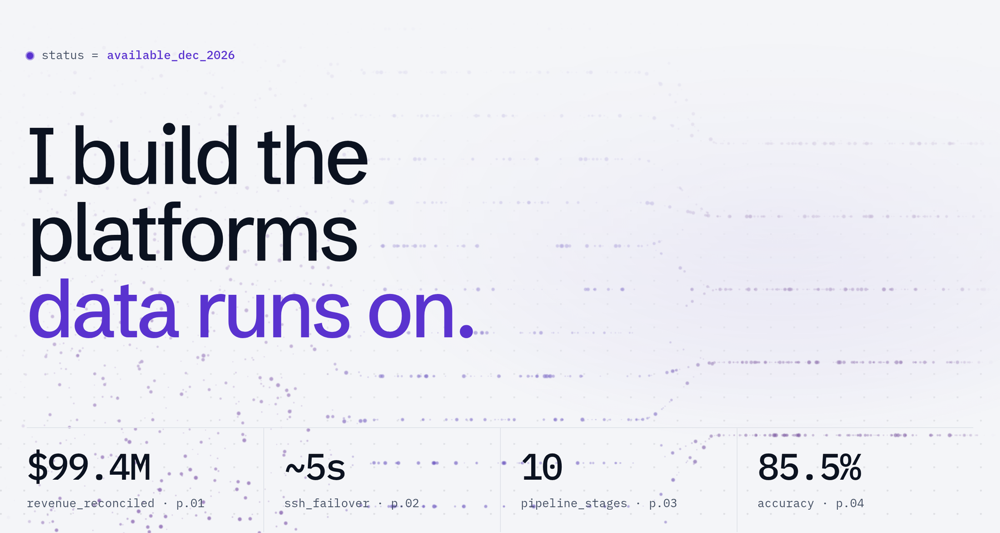

<picture>
  <source media="(prefers-color-scheme: dark)" srcset="assets/banner-dark.png">
  
</picture>

# Adrián Salvador Ekomo Mesi Obono

<code>engineering_student</code> <code>dataops · devops · mlops</code> <code>leipzig_de</code> <code>open_to_internships_from_dec_2026</code>

Data &amp; Platform Engineering student at ESPRIT, on exchange at Philipps-Universität Marburg. I look for the manual, error-prone step where infrastructure, delivery and data meet, and replace it with something that can be reviewed, tested and repeated.

[Portfolio](https://adriansalvadorekomodev.vercel.app) · [Notes](https://adriansalvadorekomodev.vercel.app/blog) · [LinkedIn](https://linkedin.com/in/adriansalvadorekomo) · [Email](mailto:adriansalvadorekomo@outlook.com) · CV [EN](cv/Adrian_Salvador_Ekomo_CV_EN.pdf) · [ES](cv/Adrian_Salvador_Ekomo_CV_ES.pdf) · [FR](cv/Adrian_Salvador_Ekomo_CV_FR.pdf)

## about

<table>
<tr><td width="60" valign="top"><code>m.01</code></td><td>reproducible_infrastructure <b>Infrastructure you can rebuild from a repo</b> Terraform and Ansible instead of hand-built servers. Every change reviewable in Git, every environment repeatable.</td></tr>
<tr><td width="60" valign="top"><code>m.02</code></td><td>quality_gated_ci_cd <b>A red gate blocks the release</b> SonarQube quality gate, fail-fast stages, immutable build tags. Nothing ships because it merely compiled.</td></tr>
<tr><td width="60" valign="top"><code>m.03</code></td><td>governed_data_pipelines <b>Bronze to Gold, with checks in between</b> Data-quality gates between layers; pipelines that are tested and observable, not just scheduled.</td></tr>
</table>

## projects

Ordered by relevance to Data Engineering, Data Platform and DevOps. Each one: the problem, what I did, what changed. Tools come last, as the medium.

<table>
<tr><td width="170" valign="top"><code>p.01</code> <b>$99.4M</b> revenue_reconciled · synthetic data</td><td><b>Reconciled $99.4M in revenue through a governed medallion lakehouse</b> DataOps Lakehouse · <a href="https://github.com/adriansalvadorekomo/DataOps-Lakehouse-for-E-commerce-Analytics">github ↗</a></td></tr>
<tr><td><code>problem</code></td><td>Reports ran ad-hoc queries straight against the operational database, and nothing checked the quality of the data they returned.</td></tr>
<tr><td><code>what_i_did</code></td><td>Built a Bronze → Silver → Gold pipeline on Databricks with a fail-fast data-quality gate (nine rules) between Silver and Gold, with the infrastructure in Terraform and pull-request-gated CI.</td></tr>
<tr><td><code>result</code></td><td>Revenue reconciles end to end — $99.4M on a synthetic dataset — and a bad batch can no longer reach the Gold marts.</td></tr>
<tr><td><code>built_with</code></td><td>Databricks · PySpark · Delta Lake · Terraform · GitHub Actions</td></tr>
</table>

<table>
<tr><td width="170" valign="top"><code>p.02</code> <b>~5s</b> ssh_failover</td><td><b>Restored SSH in ~5s with a code-defined bastion failover</b> RIF Open edX · <a href="https://github.com/adriansalvadorekomo/Stage_ete_RIF_Automatisation">github ↗</a></td></tr>
<tr><td><code>problem</code></td><td>A volunteer organisation of 10+ engineers ran hand-built servers: no infrastructure as code, no automated configuration, no high availability.</td></tr>
<tr><td><code>what_i_did</code></td><td>As the DevOps intern, defined the OpenStack infrastructure in Terraform and the server setup as idempotent Ansible roles, shipped a containerised Open edX behind Nginx with HTTPS, and designed a PRIMARY → BACKUP bastion on one Floating IP.</td></tr>
<tr><td><code>result</code></td><td>SSH access is restored in about 5 seconds in failover tests, and every infrastructure change is reviewable in Git.</td></tr>
<tr><td><code>built_with</code></td><td>OpenStack · Terraform · Ansible · Nginx · Docker</td></tr>
</table>

<table>
<tr><td width="170" valign="top"><code>p.03</code> <b>10</b> pipeline_stages</td><td><b>Killed “works on my machine” with a 10-stage quality-gated pipeline</b> PM App CI/CD · <a href="https://github.com/adriansalvadorekomo/DevOps-AppGestionDesProjets">github ↗</a></td></tr>
<tr><td><code>problem</code></td><td>A Spring Boot, Angular and MySQL app failed on every handoff: “works on my machine”, no quality check, no container strategy.</td></tr>
<tr><td><code>what_i_did</code></td><td>Wrote a 10-stage Jenkins pipeline that fails fast — build, SonarQube analysis, a quality gate that blocks a red release, multistage Docker builds with immutable tags, verified redeploy — then ported the stack to Kubernetes on minikube.</td></tr>
<tr><td><code>result</code></td><td>One command takes the app from commit to running containers, and a red quality gate stops the release.</td></tr>
<tr><td><code>built_with</code></td><td>Jenkins · SonarQube · Docker · Kubernetes · Spring Boot</td></tr>
</table>

<table>
<tr><td width="170" valign="top"><code>p.04</code> <b>85.5%</b> accuracy · recall 0.42</td><td><b>Stopped bad code from ever training a model</b> Customer Churn MLOps · <a href="https://github.com/adriansalvadorekomo/customer-churn-mlops">github ↗</a></td></tr>
<tr><td><code>problem</code></td><td>A one-off churn notebook: no tests, no schedule, and retraining by hand on the full dataset every time.</td></tr>
<tr><td><code>what_i_did</code></td><td>Separated the pipeline logic from the orchestration, blocked every run behind ruff, bandit and six pytest gates, and scheduled three staggered Prefect flows (02:00, 04:00, 06:00 UTC).</td></tr>
<tr><td><code>result</code></td><td>Retraining and re-scoring run nightly without overlap, at 85.5% accuracy. Churner recall is 0.42 — documented openly, with class imbalance named as the next fix.</td></tr>
<tr><td><code>built_with</code></td><td>Prefect · scikit-learn · ruff · bandit · pytest</td></tr>
</table>

<table>
<tr><td width="170" valign="top"><code>p.05</code> <b>30–45s</b> 16_page_chapter_summary · RTX 4060</td><td><b>Made a RAG tutor summarise whole chapters, not the five closest passages</b> Episteme · <a href="https://github.com/adriansalvadorekomo/Episteme">github ↗</a></td></tr>
<tr><td><code>problem</code></td><td>Top-k retrieval reads about 5% of a 30-page chapter, so chapter summaries skip most of it — and a small LLM fills the gaps with fluent guesses.</td></tr>
<tr><td><code>what_i_did</code></td><td>Built a course tutor that answers only from its own corpus: a Bronze/Silver lakehouse (object storage plus Iceberg), Graph-RAG retrieval over a kNN knowledge graph, and a study mode that reads a chapter section by section while the answer&#x27;s structure and citations are laid out in code.</td></tr>
<tr><td><code>result</code></td><td>Every answer is cited and carries a sentence-level verification badge. A 16-page chapter is summarised in about 30–45 seconds on a laptop RTX 4060, and a missing diagram is preferred over an invented one.</td></tr>
<tr><td><code>built_with</code></td><td>Python · FAISS · Apache Iceberg · FastAPI · Qwen2.5 · uv</td></tr>
</table>

<table>
<tr><td width="170" valign="top"><code>p.06</code> <b>4 / 4</b> business_criteria_met · feature autoencoder</td><td><b>Compared six road-anomaly models on a test set opened exactly once</b> RoadAnomaly · <a href="https://github.com/adriansalvadorekomo/RoadAnomaly-CRISPDM">github ↗</a></td></tr>
<tr><td><code>problem</code></td><td>A driving camera&#x27;s segmenter knows a closed list of classes, so a cow on the road can get called “road”. The goal: flag the pixels of anything unexpected, without knowing what it is.</td></tr>
<tr><td><code>what_i_did</code></td><td>In a team of six, trained six models on one shared split, chose thresholds on validation only and judged them once on nine sealed test photographs. My pair built the autoencoders: a pixel baseline and a feature-space one on frozen VGG16 features.</td></tr>
<tr><td><code>result</code></td><td>The feature autoencoder is the only model meeting all four business criteria, with the fewest false alarms (10 of 22 flagged blobs); DeepLabV3+ finds the most obstacles (20 of 22). Nine photographs is small, so the top three are not statistically separated — and the write-up says so.</td></tr>
<tr><td><code>built_with</code></td><td>TensorFlow · Keras · Autoencoder · VGG16 · FastAPI · Docker</td></tr>
</table>

<table>
<tr><td width="170" valign="top"><code>p.07</code> <b>11</b> dockerized_microservices · team of six</td><td><b>Unified three source systems into one star-schema warehouse</b> EventZilla · <a href="https://github.com/adriansalvadorekomo/EventZilla-BI-AI-Powered-Event-Analytics-Platform">github ↗</a></td></tr>
<tr><td><code>what_i_did</code></td><td>With a six-person academic team, built a star-schema warehouse over 3 source systems, Prophet demand forecasting (MAPE under 15%) and 11 Dockerized microservices behind nginx, orchestrated with Airflow and monitored with Prometheus and Grafana.</td></tr>
<tr><td><code>built_with</code></td><td>Airflow · MLflow · n8n · Docker · Nginx · Prometheus · Grafana</td></tr>
</table>

## notes

<table>
<tr><td width="110">05 Nov 2026</td><td><a href="https://adriansalvadorekomodev.vercel.app/blog/test-set-you-open-once">A test set you open once: how six road-anomaly models were compared</a></td><td>#deep-learning #computer-vision #evaluation</td></tr>
<tr><td width="110">05 Nov 2026</td><td><a href="https://adriansalvadorekomodev.vercel.app/blog/no-labels-zero-shot-first">The dataset has no labels. Start with zero-shot, not a classifier.</a></td><td>#nlp #rag #evaluation</td></tr>
<tr><td width="110">05 Nov 2026</td><td><a href="https://adriansalvadorekomodev.vercel.app/blog/chapter-summaries-skip-95-percent">Your RAG chapter summary skips 95% of the chapter</a></td><td>#rag #nlp #data-engineering</td></tr>
<tr><td width="110">05 Nov 2026</td><td><a href="https://adriansalvadorekomodev.vercel.app/blog/fail-fast-dq-gate-lakehouse">Put the quality gate between Silver and Gold, and make it fail fast</a></td><td>#data-engineering #devops</td></tr>
<tr><td width="110">05 Nov 2026</td><td><a href="https://adriansalvadorekomodev.vercel.app/blog/accuracy-recall-put-the-weak-number-in-the-readme">85.5% accuracy, 0.42 recall: put the weak number in the README</a></td><td>#mlops #evaluation</td></tr>
<tr><td width="110">05 Nov 2026</td><td><a href="https://adriansalvadorekomodev.vercel.app/blog/show-which-sentences-the-sources-dont-back">A small LLM will sound sure. Show which sentences your sources don&#x27;t back.</a></td><td>#rag #nlp #evaluation</td></tr>
<tr><td width="110">05 Nov 2026</td><td><a href="https://adriansalvadorekomodev.vercel.app/blog/autoencoder-pixels-or-features">Pixels or features? Two autoencoders, one alarm, very different false alarms</a></td><td>#deep-learning #computer-vision #evaluation</td></tr>
</table>

## education

<table>
<tr><td width="170">Sep 2022 – Dec 2026</td><td><b>ESPRIT School of Engineering</b> Engineering, Computer Science, ERP-BI / Data Engineering (5th year)</td></tr>
<tr><td>Oct 2026 – present</td><td><b>Philipps-Universität Marburg</b> Exchange student (Freemover), Mathematics and Computer Science</td></tr>
<tr><td>Jul – Sep 2026</td><td><b>DevOps Intern, RIF</b> (Rassemblement des Ingénieurs Francophones), remote. See p.02.</td></tr>
</table>

## certs / trainings

<table>
<tr><td width="170">training · Sep 2026</td><td>Get Started with Databricks for Data Engineering, Databricks Academy · <a href="certs/databricks-get-started-data-engineering.pdf">PDF</a></td></tr>
<tr><td>certificate · 2026</td><td>Data Engineer Associate, DataCamp · <a href="https://www.datacamp.com/certificate/DEA0018198901240">verify</a></td></tr>
<tr><td>certificate · 2026</td><td>SQL Associate, DataCamp · <a href="https://www.datacamp.com/certificate/SQA0019633928960">verify</a></td></tr>
<tr><td>certificate · 2026</td><td>Python Data Associate, DataCamp · <a href="https://www.datacamp.com/certificate/PDA0019443332398">verify</a></td></tr>
<tr><td>certificate · Oct 2026</td><td>Hedera Certified Developer Associate, The Hashgraph Association · <a href="certs/HCDA.pdf">PDF</a></td></tr>
<tr><td>certificate · Oct 2026</td><td>Hedera Business Foundation, The Hashgraph Association · <a href="certs/HBF.pdf">PDF</a></td></tr>
</table>

## languages

<code>spanish: native</code> <code>english: c1</code> <code>french: c1</code> <code>german: a1 (learning)</code>

## tools

The tools behind the projects above, for reference.

<table>
<tr><td width="170"><code>data</code></td><td>Databricks · Delta Lake · PySpark · Spark SQL · Spark Streaming · Airflow · Prefect · MLflow · star-schema modelling</td></tr>
<tr><td><code>platform_devops</code></td><td>Terraform · Ansible · OpenStack · Docker · Kubernetes · Jenkins · SonarQube · GitHub Actions · Nginx · Linux · Prometheus · Grafana</td></tr>
<tr><td><code>languages</code></td><td>Python · SQL · Bash · Java</td></tr>
</table>
