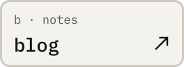
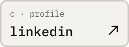
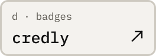
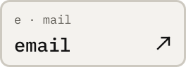

<picture>
  <source media="(prefers-color-scheme: dark)" srcset="assets/header-dark-v3.svg">
  
</picture>

<a href="https://adriansalvadorekomodev.vercel.app"><picture><source media="(prefers-color-scheme: dark)" srcset="assets/key-portfolio-dark-v3.svg"></picture></a>
<a href="https://adriansalvadorekomodev.vercel.app/blog"><picture><source media="(prefers-color-scheme: dark)" srcset="assets/key-blog-dark-v3.svg"></picture></a>
<a href="https://www.linkedin.com/in/adriansalvadorekomo"><picture><source media="(prefers-color-scheme: dark)" srcset="assets/key-linkedin-dark-v3.svg"></picture></a>
<a href="https://www.credly.com/users/adrian-salvador-ekomo-mesi-obono"><picture><source media="(prefers-color-scheme: dark)" srcset="assets/key-credly-dark-v3.svg"></picture></a>
<a href="mailto:adriansalvadorekomo@outlook.com"><picture><source media="(prefers-color-scheme: dark)" srcset="assets/key-email-dark-v3.svg"></picture></a>

