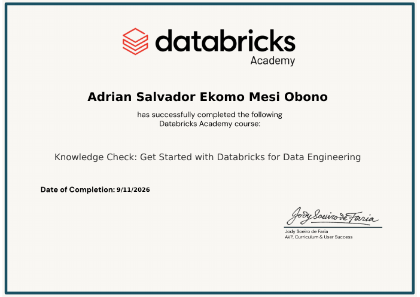
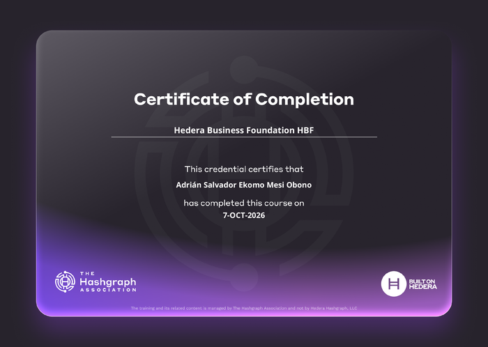

<p align="center">
  <sub>REPRODUCIBLE INFRA&ensp;⇢&ensp;QUALITY-GATED CI/CD&ensp;⇢&ensp;GOVERNED DATA PIPELINES</sub>
</p>

<h1 align="center">
  
</h1>

<p align="center">
  <b>I build the platforms data runs on.</b><br/>
  <sub>Engineering student: reproducible infrastructure as code, quality-gated CI/CD and governed data pipelines.</sub><br/>
  <sub>Seeking a <b>Data Platform / Data Engineering / DevOps internship</b> · Leipzig, Germany · Available from December 2026</sub>
</p>

<p align="center">
  <a href="https://linkedin.com/in/adriansalvadorekomo"></a>
  <a href="mailto:adriansalvadorekomo@outlook.com"></a>
  <a href="https://github.com/adriansalvadorekomo"></a>
  <a href="https://adriansalvadorekomodev.vercel.app"></a>
  <a href="https://adriansalvadorekomodev.vercel.app/blog"></a>
</p>

---

```sql
-- ABOUT ME
SELECT
  'Engineering student (ESPRIT + Marburg)' AS profile,
  'Data Platform | Data Eng | DevOps'      AS seeking,
  'Leipzig, Germany — from Dec 2026'       AS location,
  'Reproducible infra over manual steps'   AS mantra;
```

I eliminate manual, error-prone steps where infrastructure, CI/CD and data intersect: reproducible infrastructure with Terraform + Ansible, quality-gated delivery with Jenkins + SonarQube, and governed data pipelines with Databricks + Spark and Airflow / Prefect. Proof below — systems that reconcile, fail fast, and recover fast.

---

<p align="center">
  
  
</p>

---

### Selected projects

<sub>Ordered by relevance to Data Engineering, Data Platform and DevOps. Each one: the problem, what I did, what changed.</sub>

**1. Reconciled $99.4M in revenue through a governed medallion lakehouse**  
<sub>[DataOps Lakehouse](https://github.com/adriansalvadorekomo/DataOps-Lakehouse-for-E-commerce-Analytics)</sub>

- **Problem:** Reports ran ad-hoc queries straight against the operational database, and nothing checked the quality of the data they returned.
- **What I did:** Built a Bronze → Silver → Gold pipeline on Databricks with a fail-fast data-quality gate (nine rules) between Silver and Gold, with the infrastructure in Terraform and pull-request-gated CI.
- **Result:** Revenue reconciles end to end — $99.4M on a synthetic dataset — and a bad batch can no longer reach the Gold marts.
- <sub>Built with Databricks · PySpark · Delta Lake · Terraform · GitHub Actions</sub>

**2. Restored SSH in ~5s with a code-defined bastion failover**  
<sub>[RIF Open edX](https://github.com/adriansalvadorekomo/Stage_ete_RIF_Automatisation)</sub>

- **Problem:** A volunteer organisation of 10+ engineers ran hand-built servers: no infrastructure as code, no automated configuration, no high availability.
- **What I did:** As the DevOps intern, defined the OpenStack infrastructure in Terraform and the server setup as idempotent Ansible roles, shipped a containerised Open edX behind Nginx with HTTPS, and designed a PRIMARY → BACKUP bastion on one Floating IP.
- **Result:** SSH access is restored in about 5 seconds in failover tests, and every infrastructure change is reviewable in Git.
- <sub>Built with OpenStack · Terraform · Ansible · Nginx · Docker</sub>

**3. Killed “works on my machine” with a 10-stage quality-gated pipeline**  
<sub>[PM App CI/CD](https://github.com/adriansalvadorekomo/DevOps-AppGestionDesProjets)</sub>

- **Problem:** A Spring Boot, Angular and MySQL app failed on every handoff: “works on my machine”, no quality check, no container strategy.
- **What I did:** Wrote a 10-stage Jenkins pipeline that fails fast — build, SonarQube analysis, a quality gate that blocks a red release, multistage Docker builds with immutable tags, verified redeploy — then ported the stack to Kubernetes on minikube.
- **Result:** One command takes the app from commit to running containers, and a red quality gate stops the release.
- <sub>Built with Jenkins · SonarQube · Docker · Kubernetes · Spring Boot</sub>

**4. Stopped bad code from ever training a model**  
<sub>[Customer Churn MLOps](https://github.com/adriansalvadorekomo/customer-churn-mlops)</sub>

- **Problem:** A one-off churn notebook: no tests, no schedule, and retraining by hand on the full dataset every time.
- **What I did:** Separated the pipeline logic from the orchestration, blocked every run behind ruff, bandit and six pytest gates, and scheduled three staggered Prefect flows (02:00, 04:00, 06:00 UTC).
- **Result:** Retraining and re-scoring run nightly without overlap, at 85.5% accuracy. Churner recall is 0.42 — documented openly, with class imbalance named as the next fix.
- <sub>Built with Prefect · scikit-learn · ruff · bandit · pytest</sub>

**5. Made a RAG tutor summarise whole chapters, not the five closest passages**  
<sub>[Episteme](https://github.com/adriansalvadorekomo/Episteme)</sub>

- **Problem:** Top-k retrieval reads about 5% of a 30-page chapter, so chapter summaries skip most of it — and a small LLM fills the gaps with fluent guesses.
- **What I did:** Built a course tutor that answers only from its own corpus: a Bronze/Silver lakehouse (object storage plus Iceberg), Graph-RAG retrieval over a kNN knowledge graph, and a study mode that reads a chapter section by section while the answer's structure and citations are laid out in code.
- **Result:** Every answer is cited and carries a sentence-level verification badge. A 16-page chapter is summarised in about 30–45 seconds on a laptop RTX 4060, and a missing diagram is preferred over an invented one.
- <sub>Built with Python · FAISS · Apache Iceberg · FastAPI · Qwen2.5 · uv</sub>

**6. Compared six road-anomaly models on a test set opened exactly once**  
<sub>[RoadAnomaly](https://github.com/adriansalvadorekomo/RoadAnomaly-CRISPDM)</sub>

- **Problem:** A driving camera's segmenter knows a closed list of classes, so a cow on the road can get called “road”. The goal: flag the pixels of anything unexpected, without knowing what it is.
- **What I did:** In a team of six, trained six models on one shared split, chose thresholds on validation only and judged them once on nine sealed test photographs. My pair built the autoencoders: a pixel baseline and a feature-space one on frozen VGG16 features.
- **Result:** The feature autoencoder is the only model meeting all four business criteria, with the fewest false alarms (10 of 22 flagged blobs); DeepLabV3+ finds the most obstacles (20 of 22). Nine photographs is small, so the top three are not statistically separated — and the write-up says so.
- <sub>Built with TensorFlow · Keras · Autoencoder · VGG16 · FastAPI · Docker</sub>

**7. Unified three source systems into one star-schema warehouse (team of six)**  
<sub>[EventZilla](https://github.com/adriansalvadorekomo/EventZilla-BI-AI-Powered-Event-Analytics-Platform)</sub>

- **What I did:** With a six-person academic team, built a star-schema warehouse over 3 source systems, Prophet demand forecasting and 11 Dockerized microservices behind nginx, orchestrated with Airflow and monitored with Prometheus + Grafana.
- **Result:** Forecast error under 15% (MAPE).
- <sub>Built with Airflow · MLflow · n8n · Docker · Nginx · Prometheus · Grafana</sub>

Public Spark, Spark SQL and Spark Streaming notebooks are in the DataOps repository and my gists.

---

### Tools behind the projects

<table>
  <tr>
    <th align="left" width="220">Group</th>
    <th align="left">Stack</th>
  </tr>
  <tr>
    <td><b>Platform &amp; Infrastructure</b></td>
    <td>     </td>
  </tr>
  <tr>
    <td><b>Delivery &amp; Automation</b></td>
    <td>   </td>
  </tr>
  <tr>
    <td><b>Containers &amp; Orchestration</b></td>
    <td>  </td>
  </tr>
  <tr>
    <td><b>Data Engineering</b></td>
    <td>      </td>
  </tr>
  <tr>
    <td><b>Pipelines &amp; Observability</b></td>
    <td>     </td>
  </tr>
  <tr>
    <td><b>Programming</b></td>
    <td>   </td>
  </tr>
</table>

<sub>Core drivers: <b>SQL</b> · <b>Databricks</b> · <b>Terraform</b> — methods: Systems Thinking, Agile</sub>


---

### Latest notes

Study notes and project write-ups, with the numbers left honest, at [adriansalvadorekomodev.vercel.app/blog](https://adriansalvadorekomodev.vercel.app/blog):

- [A test set you open once: how six road-anomaly models were compared](https://adriansalvadorekomodev.vercel.app/blog/test-set-you-open-once)
- [The dataset has no labels. Start with zero-shot, not a classifier.](https://adriansalvadorekomodev.vercel.app/blog/no-labels-zero-shot-first)
- [Your RAG chapter summary skips 95% of the chapter](https://adriansalvadorekomodev.vercel.app/blog/chapter-summaries-skip-95-percent)

---

### Experience

**RIF – Rassemblement des Ingénieurs Francophones | DevOps Intern · France (Remote) · Jul 2026 – Sep 2026**
- Replaced hand-built servers with code (Terraform + Ansible), shipped Open edX reproducibly, 5s bastion failover.

### Education

- **ESPRIT School of Engineering** — Engineering, Computer Science ERP-BI / Data Engineering (5th year) · Sep 2022 – Dec 2026
- **Philipps-Universität Marburg** — Exchange (Freemover), Mathematics & Computer Science · Oct 2026 – present

---

### Certifications & trainings

| Certificate | Details |
|-------------|---------|
| [](certs/DEA0018198901240.pdf) | **Data Engineer Associate — DataCamp**<br/>Issued Sept 2026 · ID `DEA0018198901240`<br/>Cleaning · ETL · SQL · normalization · cloud pipelines · quality<br/>DE101 + DE501P (practical SQL) |
| [](certs/databricks-get-started-data-engineering.pdf) | **Get Started with Databricks for Data Engineering — Databricks Academy**<br/>Issued Sept 2026<br/>Lakehouse fundamentals |
| [](certs/SQA0019633928960.pdf) | **SQL Associate — DataCamp**<br/>Issued Sept 2026 · ID `SQA0019633928960` |
| [](certs/PDA0019443332398.pdf) | **Python Data Associate — DataCamp**<br/>Issued Sept 2026 · ID `PDA0019443332398`<br/>Pandas · cleaning · visualization<br/>PY101 + PY501P |
| [](certs/HCDA.pdf) | **Hedera Certified Developer Associate (HCDA) — The Hashgraph Association**<br/>Issued Oct 2026<br/>Building on Hedera: smart contracts, SDKs and testnet |
| [](certs/HBF.pdf) | **Hedera Business Foundation (HBF) — The Hashgraph Association**<br/>Issued Oct 2026<br/>Hedera network fundamentals: hashgraph, services and use cases |

---

### Languages

<p>
  
  
  
  
</p>

---

### CV

<p>
  <a href="cv/Adrian_Salvador_Ekomo_CV_EN.pdf"></a>
  <a href="cv/Adrian_Salvador_Ekomo_CV_ES.pdf"></a>
  <a href="cv/Adrian_Salvador_Ekomo_CV_FR.pdf"></a>
  
</p>
<sub>German version coming soon.</sub>

---

<p align="center">
  <i>Data Platform · Data Engineering · DevOps | Databricks · Terraform · PySpark · SQL</i>
  <br />
  <sub>Built with ✦ for the data that drives decisions</sub>
</p>
