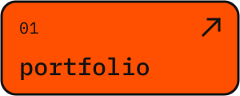
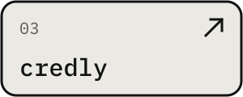
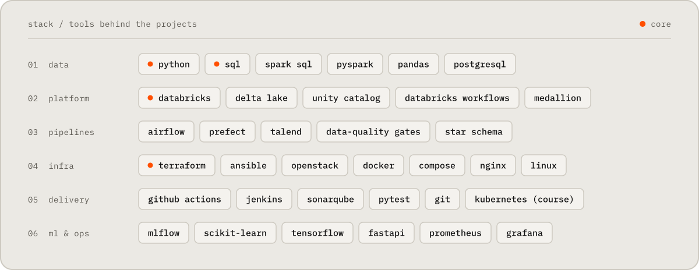

<picture>
  <source media="(prefers-color-scheme: dark)" srcset="assets/header-dark.svg">
  
</picture>

  
  
  
  

### 00 — about

Final-year Computer Science engineering student at ESPRIT (ERP-BI / Data Engineering), on an exchange semester at Philipps-Universität Marburg.
I build data pipelines that check the data before anyone reports on it, the infrastructure that ships them, and the MLOps around the models.

This profile is the evidence: every project links to its code, every number comes from that repository, and every credential links to where it can be verified.

### 01 — projects

#### [DataOps lakehouse for e-commerce analytics](https://github.com/adriansalvadorekomo/DataOps-Lakehouse-for-E-commerce-Analytics)
personal project · built alone · aug – oct 2026

PostgreSQL system of record → Databricks Bronze / Silver / Gold in Spark SQL, run as a Databricks Workflows job.

- A fail-fast quality gate (9 rules) between Silver and Gold: 1M synthetic orders pass with 0 violations, and Gold revenue reconciles to the source within ±₹1,000 (₹9.94B over 24 months).
- Terraform for schemas, volumes and the job; 10 GitHub Actions CI jobs on every pull request; a tag-triggered CD that smoke-tests the stack and validates Gold counts and revenue. Trade-offs recorded in 8 ADRs.

`databricks` `delta lake` `spark sql` `postgresql` `terraform` `github actions`

#### [RoadAnomaly — pixel-level road obstacle detection](https://github.com/adriansalvadorekomo/RoadAnomaly)
ESPRIT project · team of six · oct – nov 2026 · [landing page ↗](https://roadanomaly-landing.vercel.app)

Find unexpected obstacles in road photos, pixel by pixel: six models, one frozen protocol, a test set opened once.

- Owned integration and deployment: one data loader on a frozen split, one artefact format per model, and one Predictor class behind the notebooks, a FastAPI service and Streamlit demos, all started with Docker Compose.
- With a teammate, built the two autoencoders. The feature autoencoder was the only one of six models to meet all four business criteria: 16 of 22 obstacles found, with the fewest false alarms (10). Nine test photos, so no winner is declared.

`tensorflow` `keras` `fastapi` `streamlit` `docker compose`

#### [Episteme — grounded RAG study assistant](https://github.com/adriansalvadorekomo/Episteme)
personal project · built alone · nov 2026

A study assistant that answers only from its course material, and cites it.

- Documents land in S3-compatible storage and Apache Iceberg tables (Bronze / Silver), from which a FAISS index is rebuilt. Retrieval walks a similarity graph (Graph-RAG), and a local Qwen2.5 model is served behind FastAPI (73 tests).
- Every answer is checked sentence by sentence against its sources: on a 10-question test, 162 of 185 statements (88%) were backed, up from 78%.

`python` `apache iceberg` `faiss` `fastapi` `qwen2.5`

#### [Customer churn MLOps pipeline](https://github.com/adriansalvadorekomo/customer-churn-mlops)
personal project · sep – oct 2026

A bank-churn notebook turned into a tested, scheduled pipeline.

- Pipeline logic separated from Prefect 3 flows; ruff, bandit and pytest gate the nightly full run; every training run is logged to MLflow.
- A FastAPI `/predict` endpoint and a dashboard, packaged as 5 Docker Compose services. 85.5% accuracy on a 2,000-customer holdout, with the weak churner recall (0.42) reported openly.

`prefect` `scikit-learn` `mlflow` `fastapi` `pytest` `docker compose`

#### [Quality-gated CI/CD for a Spring Boot + Angular app](https://github.com/adriansalvadorekomo/DevOps-AppGestionDesProjets)
ESPRIT DevOps module · sep – oct 2026

The application code was provided; I built the delivery layer.

- A 10-stage Jenkins pipeline: Maven and npm builds, SonarQube analysis with a blocking quality gate, multistage Docker builds, immutable build-number tags, push, and a deploy verified with curl.
- A Docker Compose stack in which the backend starts only after the MySQL health check passes, with credentials from the environment.

`jenkins` `sonarqube` `docker` `docker compose`

#### [EventZilla BI — event analytics platform](https://github.com/adriansalvadorekomo/EventZilla-BI-AI-Powered-Event-Analytics-Platform)
ESPRIT project · team of six · feb – may 2026

Event, booking and marketing data unified so organisers can see which events make money.

- Designed the PostgreSQL star schema (a revenue fact table with 14 dimensions) and built the Talend ETL jobs, orchestrated with Apache Airflow, with teammates.
- Integrated the platform as a Docker Compose stack behind Nginx (PostgreSQL, FastAPI, Flask, Angular, n8n, Prometheus, Grafana) and wrote the Prophet forecasting job tracked in MLflow.

`postgresql` `talend` `airflow` `mlflow` `power bi` `grafana`

### 02 — experience

#### DevOps Intern · RIF (Rassemblement des Ingénieurs Francophones)
internship · france, remote · jul – sep 2026 · [repository ↗](https://github.com/adriansalvadorekomo/Stage_ete_RIF_Automatisation)

Automation & Improvement team (three interns) on the association's private OpenStack cloud.

- Wrote the Ansible automation that publishes private VMs through the bastion host: an idempotent Nginx reverse-proxy role with per-site Let's Encrypt TLS (Certbot), DuckDNS updates, UFW firewall rules and built-in validation tasks.
- Published five sites over HTTPS behind a single public floating IP (Open edX LMS and its app, Odoo and two web apps), so the organisation no longer needed one public IP per VM.
- Contributed security-group changes to the Terraform-managed environment (fellow interns built the provisioning and the Keepalived bastion pair), and wrote the runbook and architecture diagrams.

### 03 — stack

<picture>
  <source media="(prefers-color-scheme: dark)" srcset="assets/stack-dark.svg">
  
</picture>

Everything on this panel is used in the projects above, except Kubernetes, which comes from the LFS162 course (see credentials).

### 04 — credentials

| credential | issuer | type | date | skills it backs (issuer's list) | verify |
|---|---|---|---|---|---|
| Databricks Fundamentals Accreditation | Databricks Academy | accreditation | nov 2026 | Databricks Data Intelligence (lakehouse) platform fundamentals | [credential.net ↗](https://www.credential.net/0d41fdab-06f5-4212-b562-566f1c461d27) |
| Associate Data Engineer | DataCamp | certificate | sep 2026 | sql · etl · data cleaning · data quality | [datacamp ↗](https://www.datacamp.com/certificate/DEA0018198901240) |
| SQL Associate | DataCamp | certificate | sep 2026 | sql | [datacamp ↗](https://www.datacamp.com/certificate/SQA0019633928960) |
| Python Data Associate | DataCamp | certificate | sep 2026 | python · pandas · data cleaning · visualization | [datacamp ↗](https://www.datacamp.com/certificate/PDA0019443332398) |
| AWS Academy Graduate – Cloud Foundations | AWS Academy | training badge | nov 2026 | aws cloud · core services · architecture · pricing · support | [credly ↗](https://www.credly.com/badges/c5a1a906-97cb-4599-8394-0b85fb5a9dc2) |
| LFS162: Introduction to DevOps and Site Reliability Engineering | The Linux Foundation | course badge | nov 2026 | devops · sre · ci/cd · containers · iac · kubernetes | [credly ↗](https://www.credly.com/badges/72a292ae-a5e5-4d07-99d8-d6549c71984e) |
| LFS101: Introduction to Linux | The Linux Foundation | course badge | nov 2026 | linux · bash shell · command line · scripting · system configuration | [credly ↗](https://www.credly.com/badges/472b36fc-71af-4f54-a027-336df6c53676) |

All three Credly badges are on [credly.com/users/adrian-salvador-ekomo-mesi-obono](https://www.credly.com/users/adrian-salvador-ekomo-mesi-obono). Course and training badges show foundations, not production experience.

### 05 — education

- **ESPRIT School of Engineering**, Tunis — Engineering degree in Computer Science, ERP-BI / Data Engineering · sep 2022 – 2027 (expected).
- **Philipps-Universität Marburg** — exchange semester, enrolled in Computer Science (Department of Mathematics and Computer Science) · oct 2026 – mar 2027.

### 06 — languages

spanish native · english C1 · french C1 · german A1 (learning)

### 07 — notes

Project write-ups, with the weak numbers left in, at [adriansalvadorekomodev.vercel.app/blog](https://adriansalvadorekomodev.vercel.app/blog):

- [Put the quality gate between Silver and Gold, and make it fail fast](https://adriansalvadorekomodev.vercel.app/blog/fail-fast-dq-gate-lakehouse)
- [A test set you open once: how six road-anomaly models were compared](https://adriansalvadorekomodev.vercel.app/blog/test-set-you-open-once)
- [A small LLM will sound sure. Show which sentences your sources don't back.](https://adriansalvadorekomodev.vercel.app/blog/show-which-sentences-the-sources-dont-back)
- [85.5% accuracy, 0.42 recall: put the weak number in the README](https://adriansalvadorekomodev.vercel.app/blog/accuracy-recall-put-the-weak-number-in-the-readme)

---

adrián salvador ekomo · data engineering + devops · leipzig, de · rev 2026.11 · images drawn by <code>tools/build_assets.py</code> from the portfolio's mark and fonts
